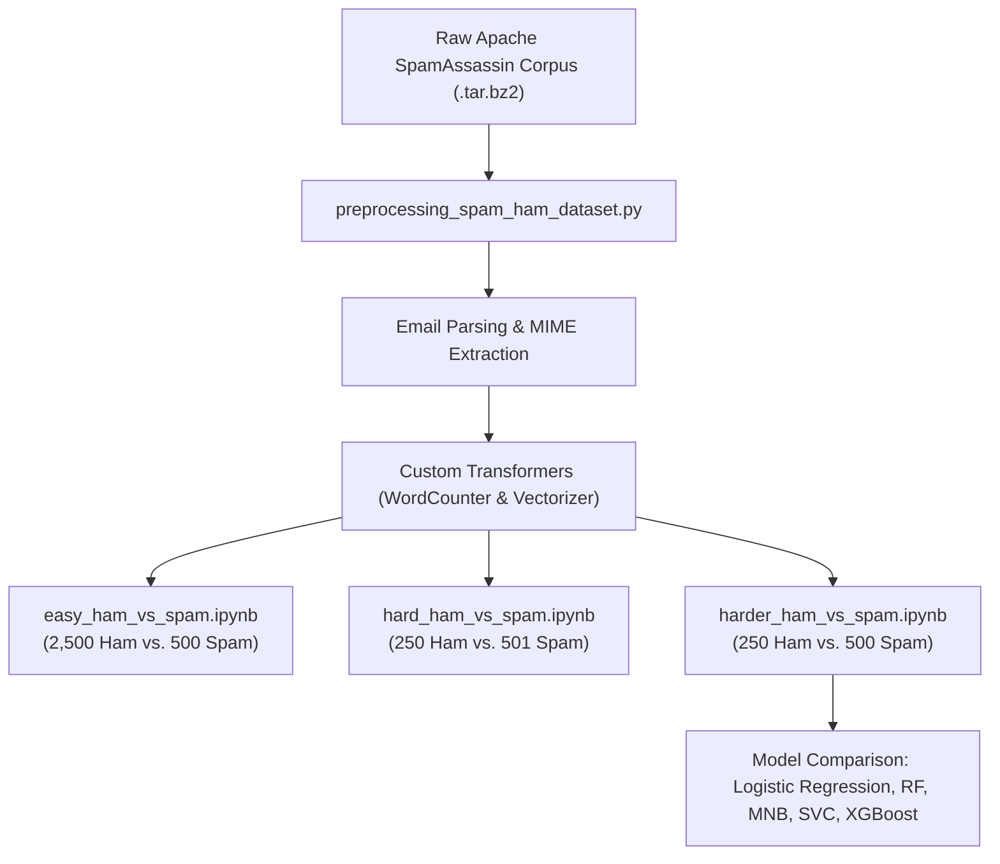
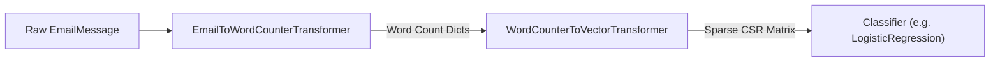
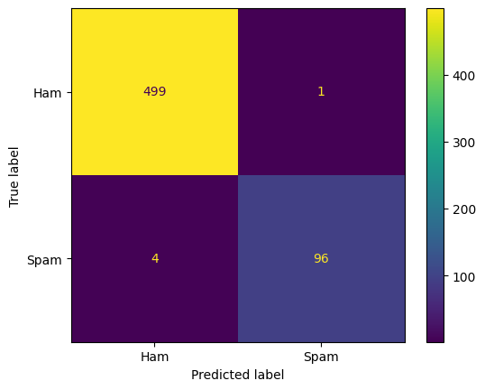
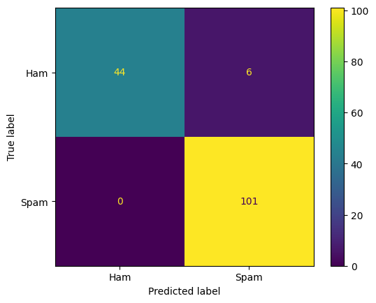
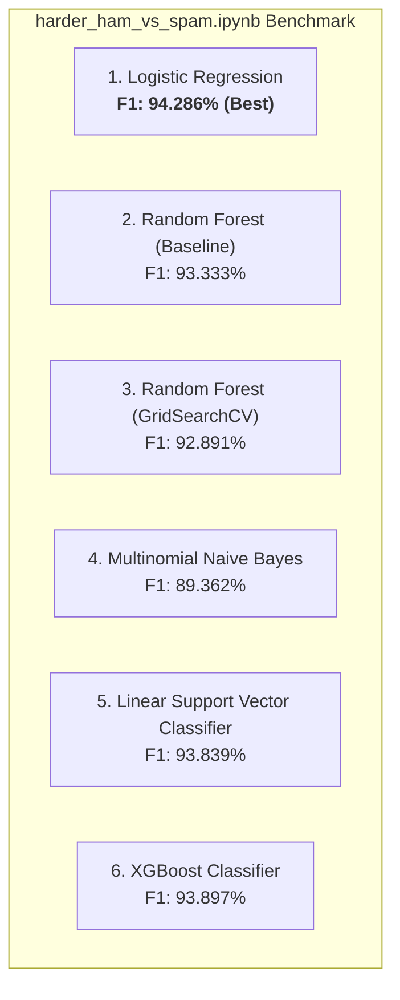
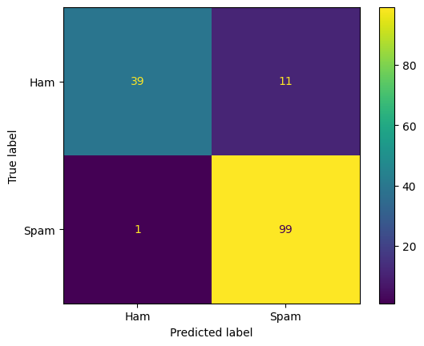

# Spam vs. Ham Email Classification

An end-to-end Machine Learning pipeline and empirical investigation into email spam classification using the **Apache SpamAssassin Public Corpus**. This project demonstrates how text preprocessing, feature engineering, and class distribution shifts impact spam detection performance—progressing from clean, straightforward emails (**Easy Ham**) to deceptive, HTML- and URL-saturated newsletters (**Hard Ham** and **Harder Ham**).

---

## Table of Contents
1. [Project Overview](#project-overview)
2. [Repository Structure](#repository-structure)
3. [Sequential Workflow & Methodology](#sequential-workflow--methodology)
   - [1. Data Ingestion & Preprocessing Pipeline (`preprocessing_spam_ham_dataset.py`)](#1-data-ingestion--preprocessing-pipeline-preprocessing_spam_ham_datasetpy)
   - [2. Easy Ham vs. Spam (`easy_ham_vs_spam.ipynb`)](#2-easy-ham-vs-spam-easy_ham_vs_spamipynb)
   - [3. Hard Ham vs. Spam (`hard_ham_vs_spam.ipynb`)](#3-hard-ham-vs-spam-hard_ham_vs_spamipynb)
   - [4. Harder Ham vs. Spam — Algorithm Benchmark (`harder_ham_vs_spam.ipynb`)](#4-harder-ham-vs-spam--algorithm-benchmark-harder_ham_vs_spamipynb)
4. [Comparative Results Across Difficulty Levels](#comparative-results-across-difficulty-levels)
5. [Key Empirical Insights](#key-empirical-insights)
6. [Installation & Requirements](#installation--requirements)

---

## Project Overview

Spam filtering is often perceived as an easy natural language processing task when legitimate emails (*ham*) are plain text personal communications and spam messages are overt promotional advertisements. However, in modern corporate environments, legitimate emails frequently include automated marketing communications, financial digests, and tech newsletters. These contain:
- Complex nested multipart MIME structures and HTML markup.
- Dense collections of external hyperlinks and tracking URLs.
- Promotional layouts and call-to-action phrasing.

This repository systematically evaluates spam classification across escalating levels of difficulty, examining both the **effect of severe training sample scarcity** and **the confounding nature of spam-like features in legitimate emails**.

---

## Repository Structure

```text
Spam-classifier/
├── assets/                                      # Extracted evaluation figures and confusion matrices
│   ├── easy_ham_cm.png
│   ├── hard_ham_cm.png
│   ├── harder_ham_logistic_regression_cm.png
│   ├── harder_ham_multinomial_nb_cm.png
│   ├── harder_ham_svc_cm.png
│   └── harder_ham_xgboost_cm.png
├── preprocessing_spam_ham_dataset.py           # Core preprocessing library and Scikit-Learn transformers
├── easy_ham_vs_spam.ipynb                      # Baseline: 2,500 clean ham vs. 500 spam
├── hard_ham_vs_spam.ipynb                      # Challenge: 250 HTML/URL-heavy ham vs. 501 spam
├── harder_ham_vs_spam.ipynb                    # Benchmark: Multi-model evaluation on 250 deceptive ham vs. 500 spam
└── README.md                                   # Comprehensive documentation
```

---

## Sequential Workflow & Methodology



---

### 1. Data Ingestion & Preprocessing Pipeline (`preprocessing_spam_ham_dataset.py`)

The file `preprocessing_spam_ham_dataset.py` acts as the foundational engine for the entire project. It handles raw archive downloads, MIME email parsing, HTML stripping, text normalization, and custom Scikit-Learn vectorization.

#### Utility Functions

- **`fetch_spam_data(ham_file_name, spam_file_name, ham_dir_name, spam_dir_name)`**:
  - Connects to the Apache SpamAssassin public corpus (`http://spamassassin.apache.org/old/publiccorpus/`).
  - Downloads `.tar.bz2` compressed archives for both ham and spam partitions.
  - Automatically extracts archives into `datasets/spams/` using Python's `tarfile` module with secure data filters and returns file path references.

- **`load_email(filepath)`**:
  - Opens raw email files in binary mode (`'rb'`).
  - Parses headers and payloads into Python standard `email.message.EmailMessage` objects using `email.parser.BytesParser(policy=email.policy.default)`.

- **`get_email_structure(email)`**:
  - Traverses email payloads recursively to determine MIME content structure.
  - Identifies multipart formats (e.g., `multipart(text/plain,text/html)`, `multipart(text/plain,application/pgp-signature)`) or single MIME types (`text/plain`, `text/html`).

- **`structure_counter(emails)`**:
  - Aggregates emails by their structural type using `collections.Counter`.
  - Indexes message occurrences to uncover structural patterns across spam and ham.

- **`html_to_plain(html)`**:
  - A robust regular-expression cleaning routine:
    1. Removes `<head>...</head>` sections and scripts via `re.sub(r'<head.*?>.*?</head>', '', html, flags=re.S|re.I)`.
    2. Converts anchor hyperlinks `<a ...>` into a dedicated token `'HYPERLINK'`.
    3. Strips all remaining HTML tags using `<.*?>`.
    4. Condenses excessive whitespace and repeated newlines into single line breaks.
    5. Converts HTML entities (e.g., `&amp;`, `&lt;`, `&nbsp;`) into standard characters via `html.unescape()`.

- **`email_to_text(email)`**:
  - Walks through the email MIME tree via `email.walk()`.
  - Extracts text from `text/plain` parts directly.
  - If parts are `text/html`, extracts the markup and runs `html_to_plain()` to extract clean textual content.

#### Custom Scikit-Learn Transformers

To enable seamless integration with Scikit-Learn's `Pipeline`, two custom transformer classes were implemented adhering to the `BaseEstimator` and `TransformerMixin` API:



#### 1. `EmailToWordCounterTransformer`
- **Role**: Converts raw `EmailMessage` objects into word frequency mappings (`collections.Counter`).
- **Configurable Parameters**:
  - `strip_headers=True`: Strips email headers or optionally prepends them to text.
  - `lower_case=True`: Lowercases all text for vocabulary normalization.
  - `replace_urls=True`: Uses `urlextract.URLExtract()` to detect URLs and replaces them with a normalized token `'URL'`.
  - `replace_numbers=True`: Substitutes numeric expressions, decimals, and scientific notation with `'NUMBER'`.
  - `remove_punctuation=True`: Replaces non-alphanumeric punctuation characters with whitespace using regex `\W+`.
  - `stemming=True`: Applies Porter Stemming (`nltk.PorterStemmer()`) so that inflected words (e.g., *computing*, *computers*, *computed*) collapse to a single root stem.

#### 2. `WordCounterToVectorTransformer`
- **Role**: Converts word frequency dictionaries into a high-dimensional sparse document-term matrix (`scipy.sparse.csr_matrix`).
- **Configurable Parameters**: `vocabulary_size=1000` (default).
- **Mechanism**:
  - **`fit(X, y)`**: Aggregates word frequencies across training emails. Word counts per email are capped at 10 (`min(count, 10)`) to prevent excessively repetitive spam messages from skewing word importance. It identifies the top `vocabulary_size` words and assigns each a 1-based column index (index 0 is reserved for out-of-vocabulary words).
  - **`transform(X)`**: Builds compressed sparse row (CSR) matrices where each row represents an email and each column corresponds to word frequencies within the vocabulary.

---

### 2. Easy Ham vs. Spam (`easy_ham_vs_spam.ipynb`)

#### Dataset Characteristics
- **Ham Source**: `20030228_easy_ham.tar.bz2` (2,500 samples).
- **Spam Source**: `20030228_spam.tar.bz2` (500 samples).
- **Class Ratio**: 5:1 Ham majority (3,000 total emails).
- **Structural Properties**:
  - **2,408 out of 2,500 ham emails (96.3%)** are simple, clean `text/plain` messages.
  - 66 ham emails contain digital signatures (`multipart(text/plain, application/pgp-signature)`).
  - Only 8 ham emails have HTML parts.
  - Ham messages consist almost exclusively of conversational text, discussions, and open-source project threads with minimal URLs and zero promotional copy.

#### Learning Paradigm
- **Train/Test Split**: 80% train (2,000 ham, 400 spam), 20% test (500 ham, 100 spam) with stratified sampling (`random_state=42`).
- **Pipeline Architecture**:
  ```python
  preprocess_pipeline = Pipeline([
      ("email_to_word_count", EmailToWordCounterTransformer()),
      ("word_count_to_vector", WordCounterToVectorTransformer())
  ])
  log_pipeline = make_pipeline(preprocess_pipeline, LogisticRegression(max_iter=1000, random_state=42))
  ```
- **Validation**: 3-Fold Cross-Validation accuracy: **98.29%**.

#### Test Results & Confusion Matrix
- **Accuracy**: **99.167%**
- **Precision**: **98.969%**
- **Recall**: **96.000%**
- **F1-Score**: **97.462%**

| Metric | Ham (0) | Spam (1) | Overall |
| :--- | :---: | :---: | :---: |
| **Precision** | 0.992 | 0.990 | 0.992 |
| **Recall** | 0.998 | 0.960 | 0.992 |
| **F1-Score** | 0.995 | 0.975 | 0.992 |
| **Support** | 500 | 100 | 600 |

<p align="center">
  
</p>

> **Key Takeaway**: Because easy ham contains virtually no HTML formatting or URLs, the classifier achieves near-perfect separation, yielding only **1 false positive** out of 500 legitimate test emails.

---

### 3. Hard Ham vs. Spam (`hard_ham_vs_spam.ipynb`)

#### Dataset Characteristics
- **Ham Source**: `20021010_hard_ham.tar.bz2` (**250 samples**).
- **Spam Source**: `20021010_spam.tar.bz2` (501 samples).
- **Class Ratio**: 1:2 Ham minority (751 total emails).

#### Why Classification Becomes Much Harder
1. **Severe Sample Scarcity**: Legitimate ham samples drop by 90% (from 2,500 down to merely 250).
2. **Prevalence of HTML**: 120 out of 250 ham emails (48%) are formatted as `text/html`, and another 38 are `multipart(text/plain, text/html)`.
3. **Surge in URLs & Promotional Layouts**: The ham emails in this dataset are tech newsletters (e.g., CNET news alerts, Wi-Fi articles) containing dense link lists, image references, unsubscribe links, and marketing-style formatting.
4. **No PGP Signatures**: Lacks explicit cryptographic markers.
5. **Feature Collision**: Features that previously served as strong spam signals (such as presence of HTML tables, `URL` tokens, and `NUMBER` tokens) now appear frequently in ham, significantly increasing the probability of false alarms.

#### Learning Paradigm
- **Train/Test Split**: 80% train (200 ham, 401 spam), 20% test (50 ham, 101 spam) with stratified sampling (`random_state=42`).
- **Pipeline Architecture**: Same end-to-end Scikit-Learn Pipeline (`EmailToWordCounterTransformer` + `WordCounterToVectorTransformer` + `LogisticRegression`).
- **Validation**: 3-Fold Cross-Validation accuracy: **95.50%**.

#### Test Results & Confusion Matrix
- **Accuracy**: **96.026%**
- **Precision**: **94.393%**
- **Recall**: **100.000%**
- **F1-Score**: **97.115%**

| Metric | Ham (0) | Spam (1) | Overall |
| :--- | :---: | :---: | :---: |
| **Precision** | 1.000 | 0.944 | 0.960 |
| **Recall** | 0.880 | 1.000 | 0.960 |
| **F1-Score** | 0.936 | 0.971 | 0.960 |
| **Support** | 50 | 101 | 151 |

<p align="center">
  
</p>

> **Key Takeaway**: The classifier maintained a 100% spam recall rate (catching all 101 spam emails), but at the expense of **6 false positives** out of 50 ham emails (a 12% false alarm rate), directly caused by the high density of URLs and HTML structures in legitimate newsletters.

---

### 4. Harder Ham vs. Spam — Algorithm Benchmark (`harder_ham_vs_spam.ipynb`)

#### Dataset Characteristics
- **Ham Source**: `20030228_hard_ham.tar.bz2` (**250 samples**).
- **Spam Source**: `20030228_spam.tar.bz2` (500 samples).
- **Class Ratio**: 1:2 Ham minority (750 total emails).
- **Structural Properties**:
  - Ham consists of financial digests (*The Motley Fool Personal Finance*), tech digests (*The Register*), and e-commerce notifications.
  - These emails feature commercial layouts, promotional headings, calls to action, and dozens of external links per email.
- **Train/Test Split**: 80% train (200 ham, 400 spam), 20% test (50 ham, 100 spam) with stratified sampling (`random_state=42`).

#### Evaluated Learning Algorithms

To determine whether more sophisticated non-linear or ensemble architectures could better distinguish deceptive ham from spam, six modeling approaches were benchmarked:



#### Detailed Breakdown by Algorithm

1. **Logistic Regression (`LogisticRegression(max_iter=1000, random_state=42)`)**:
   - 3-Fold Cross-Validation: **93.00%**.
   - Test Accuracy: **92.000%** | Precision: **90.000%** | Recall: **99.000%** | **F1-Score: 94.286%**.
   - Achieved the **highest F1-score** across all tested algorithms. It produced only 1 false negative while correctly identifying 99 out of 100 spam emails.

2. **Random Forest Classifier — Baseline (`RandomForestClassifier(random_state=42)`)**:
   - Test Accuracy: **90.667%** | Precision: **89.091%** | Recall: **98.000%** | **F1-Score: 93.333%**.
   - Solid baseline performance, correctly identifying 98 spam emails but generating 12 false positives on ham.

3. **Random Forest Classifier — Tuned (`GridSearchCV`)**:
   - Explored grid: `n_estimators: [100, 200]`, `max_features: ['sqrt', 'log2']`, `min_samples_split: [2, 5]`, `min_samples_leaf: [1, 2]` optimizing for `scoring='f1'`.
   - Best parameters found: `{'max_features': 'sqrt', 'min_samples_leaf': 1, 'min_samples_split': 2, 'n_estimators': 100}`.
   - Test Accuracy: **90.000%** | Precision: **88.288%** | Recall: **98.000%** | **F1-Score: 92.891%**.
   - *Observation*: Grid search selected parameters identical to default settings, illustrating that tree-based decision surfaces struggle with high-dimensional, sparse bag-of-words text without dense embeddings.

4. **Multinomial Naive Bayes (`MultinomialNB()`)**:
   - Test Accuracy: **86.667%** | Precision: **95.455%** | Recall: **84.000%** | **F1-Score: 89.362%**.
   - Produced the fewest false positives on ham (only 4 false positives, precision 95.45%), but suffered from poor spam recall (84.00%), allowing 16 spam emails to slip through.

5. **Linear Support Vector Classifier (`LinearSVC()`)**:
   - Test Accuracy: **91.333%** | Precision: **89.189%** | Recall: **99.000%** | **F1-Score: 93.839%**.
   - Performed closely to Logistic Regression, exhibiting strong linear separability in the 1,000-dimensional vocabulary space.

6. **XGBoost Classifier (`XGBClassifier(n_estimators=100, max_depth=6, learning_rate=0.1, ...)`)**:
   - Test Accuracy: **91.333%** | Precision: **88.496%** | Recall: **100.000%** | **F1-Score: 93.897%**.
   - Successfully caught 100% of spam emails (0 false negatives), but had 13 false positives on ham.

#### Algorithm Performance Summary Table

| Model | Test Accuracy | Precision (Spam) | Recall (Spam) | F1-Score (Spam) | Ham Recall (TN / 50) | Spam Recall (TP / 100) |
| :--- | :---: | :---: | :---: | :---: | :---: | :---: |
| **Logistic Regression (Best F1)** | **92.000%** | **90.000%** | **99.000%** | **94.286%** | **39 / 50 (78%)** | **99 / 100 (99%)** |
| **XGBoost Classifier** | 91.333% | 88.496% | **100.000%** | 93.897% | 37 / 50 (74%) | 100 / 100 (100%) |
| **Linear Support Vector (SVC)** | 91.333% | 89.189% | 99.000% | 93.839% | 38 / 50 (76%) | 99 / 100 (99%) |
| **Random Forest (Baseline)** | 90.667% | 89.091% | 98.000% | 93.333% | 38 / 50 (76%) | 98 / 100 (98%) |
| **Random Forest (GridSearch Tuned)** | 90.000% | 88.288% | 98.000% | 92.891% | 37 / 50 (74%) | 98 / 100 (98%) |
| **Multinomial Naive Bayes** | 86.667% | **95.455%** | 84.000% | 89.362% | **46 / 50 (92%)** | 84 / 100 (84%) |

#### Best Performing Model Confusion Matrix: Logistic Regression
The best F1-score (**94.286%**) was achieved by **Logistic Regression**:

<p align="center">
  
</p>

---

## Comparative Results Across Difficulty Levels

| Dataset Challenge | Ham Count | Spam Count | Primary Difficulty Driver | Best Model | Test Accuracy | Spam Recall | Spam Precision | Spam F1-Score |
| :--- | :---: | :---: | :--- | :--- | :---: | :---: | :---: | :---: |
| **Easy Ham** | 2,500 | 500 | None (Clean plain text vs. overt spam) | Logistic Regression | **99.17%** | 96.00% | **98.97%** | **97.46%** |
| **Hard Ham** | 250 | 501 | 10x fewer ham samples; 48% HTML emails; high URL density | Logistic Regression | **96.03%** | **100.00%** | 94.39% | **97.12%** |
| **Harder Ham** | 250 | 500 | Deceptive financial/tech newsletters; heavy URL & marketing mimicry | Logistic Regression | **92.00%** | 99.00% | 90.00% | **94.29%** |

---

## Key Empirical Insights

1. **The Confounding Role of URLs and HTML Markup**:
   In simple datasets, presence of hyperlinks and HTML formatting correlates heavily with spam. When evaluating newsletters (*Hard Ham* and *Harder Ham*), legitimate emails inherit these exact characteristics, dropping ham classification specificity and increasing false positives from 0.2% up to 22%.
2. **Impact of Sample Scarcity**:
   A 90% reduction in legitimate training data (from 2,500 to 250) prevents the vectorizer from capturing diverse ham vocabulary, skewing predictions toward the majority class (spam).
3. **Linear Models Dominate Sparse Bag-of-Words**:
   Across the multi-model benchmark, **Logistic Regression** and **LinearSVC** consistently outperformed complex non-linear tree ensembles (**Random Forest** and **XGBoost**). In high-dimensional sparse feature spaces (1,000+ vocabulary tokens), linear hyperplanes generalize better without overfitting to sparse co-occurrences.
4. **Precision-Recall Tradeoff in Naive Bayes**:
   Multinomial Naive Bayes proved exceptionally resistant to false positives (92% ham recall), but failed to catch 16% of spam messages, rendering it sub-optimal when high overall F1-score is desired.

---

## Installation & Requirements

### Dependencies
Install the required packages using `pip`:
```bash
pip install numpy pandas matplotlib scikit-learn nltk urlextract xgboost
```

### Reproducing the Experiments
1. Ensure `preprocessing_spam_ham_dataset.py` is located in the working directory or Python path.
2. Execute notebooks sequentially:
   - `easy_ham_vs_spam.ipynb`
   - `hard_ham_vs_spam.ipynb`
   - `harder_ham_vs_spam.ipynb`
3. Archives will be automatically downloaded from the Apache SpamAssassin server into `datasets/spams/` upon executing the first cell of each notebook.
